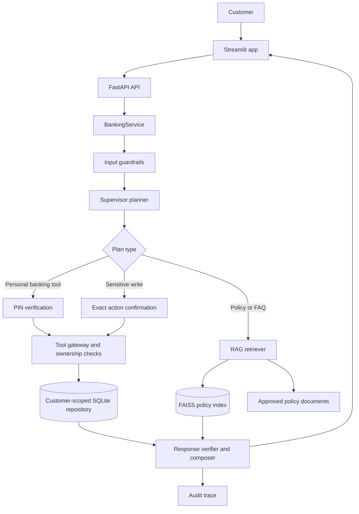

# SecureBank AI Assistant

A local development prototype for a secure, conversational banking assistant. It combines a Streamlit chat interface, a FastAPI service, customer-scoped banking tools backed by SQLite, and policy retrieval backed by a persistent FAISS index.

> **Development demo only.** The records are synthetic. This project is not connected to a bank and is not suitable for production. Production mode is disabled. The application does not transfer money, execute payments, issue cards, or send external notifications.

## What the project demonstrates

- Banking questions routed to bounded account, payments, cards, loans, and fraud tool groups.
- Customer-scoped database reads and PIN authorization for personal data.
- Exact-action confirmation for card-block and dispute-write requests.
- Policy and FAQ retrieval from approved documents, with citations.
- Local FAISS persistence for policy vectors.
- In-app alerts for high-risk or confirmed-fraud records returned by a fraud check. The prototype does not detect fraud in the background.
- Audit traces, response validation, guardrails, and offline evaluation datasets.

The agent names describe bounded tool groups. The supervisor plans a request; the backend performs tools and composes the response. The application does not run a separate autonomous LLM for each agent.

## Architecture and request flow



For a personal query, the service validates the planned tools and asks for a PIN before retrieving protected records. For writes, it also requires confirmation of that exact operation. Public policy questions use the retrieval pipeline and return citations. Unsupported requests receive a safe refusal instead of an invented banking answer.

### Example paths

1. **“What is my current balance?”** Streamlit sends `/chat` → FastAPI authenticates the session → the supervisor plans `get_balance` → the service asks for a PIN → `PinVerifier` checks the stored Argon2id hash → the gateway calls the configured repository for the current customer → the verifier and deterministic composer format the answer → Streamlit displays it.
2. **“What is the procedure for a failed UPI transaction?”** The supervisor selects RAG → the retriever searches approved document chunks in FAISS → the response includes relevant text and citations. No banking record is retrieved.
3. **“Block card CARD0001D.”** The service requires PIN verification and then exact confirmation → the gateway verifies the operation scope and ownership → the repository applies the block to the local demo database → the result is audited and displayed.
4. **“Show my fraud alerts.”** The fraud tool reads only the authenticated customer’s records. High-risk records under investigation display an in-app warning; confirmed-fraud records display a critical alert. No external notification is sent.

## Components

| Path | Responsibility |
|---|---|
| `app/streamlit_app.py` | Chat UI, local demo identity selection, PIN form, confirmation controls, citations, and in-app fraud alerts |
| `app/api/main.py` | FastAPI endpoints, trusted session checks, and HTTP safety headers |
| `app/service.py` | Request lifecycle, planning handoff, PIN/confirmation gate, tool/RAG execution, audit, and answer composition |
| `app/agents/supervisor.py` | Deterministic request routing by default; optional OpenRouter function-call planning |
| `app/agents/agents.py` | Agent catalogue and bounded tool ownership validators |
| `app/tools/registry.py` | Tool-to-domain mapping and plan validation |
| `app/tools/banking_tools.py`, `app/tools/gateway.py` | Tool execution, authorization scope checks, and repository gateway |
| `app/data/securebank_dataset_repository.py` | Adapter for the supplied synthetic SecureBank SQLite schema |
| `app/data/sqlite_repository.py` | Adapter for the documented generic SQLite contract |
| `app/data/mock_repository.py` | In-memory synthetic repository for local development and tests |
| `app/auth/` | Development sessions, PIN verification, and authorization context |
| `app/rag/retrieval.py` | Approved document ingestion, embeddings, FAISS search, and citations |
| `knowledge_base/` | Approved Markdown policy sources, manifest, and optional generated PDF copies |
| `app/safety/` | Input guardrails and allowlisted result validation |
| `app/monitoring/audit.py` | Local audit event recording |
| `scripts/` | PIN setup, FAISS build helpers, audit inspection, and policy PDF generation |
| `evals/` | Golden datasets, DeepEval runner, evaluation metrics, and report generation |
| `tests/` | API, auth, data, tools, retrieval, UI, and security test suites |
| `docs/` | Dataset setup, database contract, architecture, and verification notes |
| `reports/` | Generated evaluation summaries and charts (no runtime database) |

## Data stores

### Banking records: SQLite

For the supplied synthetic dataset, the app reads `runtime/data/securebank_demo.db` using `SecureBankDatasetRepository`. This database is local and intentionally excluded from Git. Copy an authorized dataset file to that location; do not upload real or confidential customer data to GitHub.

Set these values in your local `.env`:

```dotenv
REPOSITORY=securebank_dataset
DATABASE_PATH=runtime/data/securebank_demo.db
```

The adapter reads customers, accounts, transactions, payments, cards, loans, fraud alerts, offers, and consent data. It scopes queries by the authenticated customer. The source provides masked account numbers only; the app cannot return an unmasked account number that is not present in the database.

### PINs

PINs are separate from `users.password_hash`. The setup utility stores only salted Argon2id hashes in `account_security.pin_hash`; plaintext PINs are never saved to SQLite. The dataset has one account per customer for this demo. For a single account, use its account ID:

```powershell
.\.venv\Scripts\python.exe scripts\set_account_pins.py --account-id A1001
```

To provision all accounts without a PIN, omit `--account-id` and follow the hidden prompts. Choose a unique 4–12 digit PIN per account and keep it private. For the in-memory mock repository, use `scripts/set_demo_pin.py` instead.

### Policy knowledge: FAISS

Policy and FAQ files live under `knowledge_base/`. `knowledge_base/metadata/manifest.json` records approval metadata and source digests. On startup, `app/rag/retrieval.py` validates and chunks approved documents, then builds or reuses the local index at `runtime/faiss/`. The index, vectorizer state, and fingerprint are ignored by Git and can be rebuilt from the approved source files.

Default embeddings use local TF-IDF vectors with FAISS. Optional OpenRouter embeddings require `EMBEDDING_MODE=openrouter`, a supported `EMBEDDING_MODEL`, network access, and an API key. Hosted embeddings send document text and queries to the provider; use only fictional/public information.

## Run locally on Windows

Open PowerShell in `D:\HCL_Hackathon`.

1. Create the environment and install dependencies:

   ```powershell
   python -m venv .venv
   .\.venv\Scripts\python.exe -m pip install -r requirements.txt
   ```

2. Create `.env` from the template if it does not exist, then configure the local dataset path:

   ```powershell
   if (!(Test-Path .env)) { Copy-Item .env.example .env }
   ```

   Keep `.env` local. Never commit API keys or PINs.

3. Put the synthetic SQLite dataset at `runtime/data/securebank_demo.db` and provision PINs using the command above.

4. Start the API in Terminal 1:

   ```powershell
   .\.venv\Scripts\python.exe -m uvicorn app.api.main:create_app --factory --host 127.0.0.1 --port 8000 --no-access-log
   ```

5. Start Streamlit in Terminal 2:

   ```powershell
   .\.venv\Scripts\python.exe -m streamlit run app\streamlit_app.py --server.address 127.0.0.1 --server.port 8501 --browser.gatherUsageStats false
   ```

6. Open [http://127.0.0.1:8501](http://127.0.0.1:8501). Select a local demo customer in the sidebar. Personal-data questions open the secure PIN form; never type a PIN into chat.

Use one API worker. Development sessions and pending authorizations are held in process memory and expire; conversation history resets when the service restarts. Card blocks and disputes modify the local dataset copy. Restore a clean copy of the synthetic SQLite file to reset demo changes.

## Demo prompts

- “What is my name?” — profile lookup, protected by PIN.
- “What is my bank account number?” — returns the masked value available in the dataset.
- “What is my current balance?” — account tool and PIN verification.
- “Show my recent transactions.” — customer-scoped transaction lookup.
- “What is the procedure for a failed UPI transaction?” — policy retrieval with citations.
- “My payment to Amazon failed. What happened and what should I do?” — payment lookup plus policy retrieval.
- “Can I save more this month?” — spending summary and deterministic calculation.
- “Show my fraud alerts.” — PIN-protected fraud record lookup; displays an in-app alert for high-risk active or confirmed fraud records.
- “Show C1002 transactions” while signed in as C1001 — demonstrates customer-scope denial.
- “Block card CARD0001D” — PIN verification and exact confirmation before changing the local demo copy.

The synthetic dataset currently contains active high-risk alerts for some customers and cleared records for others. Select a customer with an active alert to demonstrate the warning. Alerts are generated from records in the dataset; this project does not run a fraud-detection model in the background.

## Configuration

The default `.env.example` uses deterministic routing and local TF-IDF embeddings; no provider key is required. Optional OpenRouter routing:

```dotenv
ROUTER_MODE=openrouter
OPENROUTER_API_KEY=your_local_secret
OPENROUTER_MODEL=nvidia/nemotron-3.5-lightning:free
OPENROUTER_BASE_URL=https://openrouter.ai/api/v1
```

The model proposes a structured plan; backend validation, authorization, database access, and response composition remain deterministic. When enabled, accepted chat messages are sent to OpenRouter. The free model/provider may not be appropriate for confidential data; use only fictional information.

Other settings include `API_URL`, `RAG_INDEX_DIR`, `SESSION_TTL_SECONDS`, `REQUEST_TTL_SECONDS`, `PIN_MAX_FAILURES`, and `PIN_LOCK_SECONDS`. See `app/config.py` and `.env.example`.

## Tests and evaluations

Run the automated tests:

```powershell
.\.venv\Scripts\python.exe -m pytest -q
```

Run the project evaluation suite:

```powershell
.\.venv\Scripts\python.exe -m evals.run_all_evals
```

The golden datasets cover 120 routing queries, 67 RAG cases, and 180 response scenarios. Evaluation scripts and reports are under `evals/` and `reports/`. The deterministic baseline is measured separately from live OpenRouter quality; demo metrics do not establish production quality or compliance. DeepEval dependencies are listed in `requirements-evals.txt`.

## Operational notes and limitations

- The demo identity selector and local session issuance are development-only.
- Production identity verification, shared durable sessions, persistent rate limiting, TLS deployment, live-provider evaluation, and any real bank integration remain outstanding. Production mode is intentionally disabled.
- Routing is keyword-based by default and may miss paraphrases. RAG is lexical unless hosted embeddings are configured and may retrieve irrelevant content.
- PIN lockout is process-local and resets on service restart. Use one worker.
- Fraud alerts surface records already in the dataset; no background transaction monitor or external notification delivery exists.
- Do not use real customer data, secrets, or production credentials with this prototype.

## Further documentation

- `docs/architecture.md` — trust boundaries and architecture constraints.
- `docs/dataset_setup.md` — supplied dataset setup and mapping.
- `docs/database_contract.md` and `docs/sqlite_contract.sql` — repository contract.
- `docs/verification.md` — verification and demo guidance.
